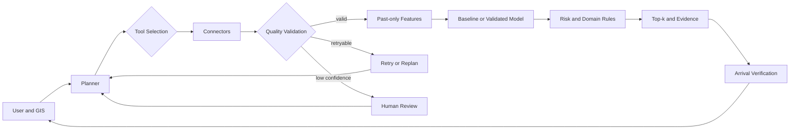

# 智慧停車 AI Agent 設計

## 1 Problem and Contract

輸入為目的地、抵達時間、車種、最大步行距離及偏好；輸出為 Top-k 停車候選、預測可用量或滿位風險、來源時間、模型、限制與替代方案。資料不足時系統必須 abstain 或轉人工確認，不能產生無證據建議。

## 2 Architecture



架構與 `docs/architecture.md`、`docs/flowchart.md` 及 Proposal pseudocode 使用同一狀態語意。

## 3 Components

| Component | Responsibility | Implementation |
|---|---|---|
| Connector | 取得 JSON，明確 timeout 與 HTTP error | `src/connectors/http_json.py` |
| Quality | schema、freshness、capacity bounds | `src/preprocessing/quality.py` |
| Baseline | 最近觀測 Persistence | `src/prediction/baseline.py` |
| Domain Rule | availability、full risk、distance score | `src/domain_rules/ranking.py` |
| Agent | plan、select、retry/replan、abstain、evidence | `src/agent/orchestrator.py` |
| Data QA | UCI duplicate、gap、coverage | `tools/analyze_uci.py` |

## 4 Data Contracts

### Roadside

- Entity key：`(source_type, Section_ID, PS_ID)`。
- Snapshot key：`(source_type, Section_ID, PS_ID, observed_at)`。
- 狀態聚合：依 `Section_ID`、snapshot time 分組，分別計算 0、1、2、unknown；unknown 不得當空位。
- 保存 `source_updated_at`、`ingested_at`、HTTP status、payload hash 與 raw payload path。

### Off-street

以來源與 `CarParkID`／官方 ID 為 entity key；保存 `TotalSpaces`、`AvailableSpaces`、service/full status 與 `DataCollectTime`。更新頻率目前 Unverified，以實際 timestamp 分布判定。

### Historical Capture

輪詢只追加、不覆寫；相同 snapshot key 與 payload hash 視為重送。Schema 變動、缺值、stale、capacity violation 與連線錯誤分開紀錄。至少 8 週且主要場站 coverage ≥ 90% 才進入臺中模型訓練。

## 5 Agent State Machine

1. Parse query and plan success criteria。
2. Select tool using capability and prior health。
3. Call and validate；retryable error 觸發 retry/replan。
4. 無有效來源或低信心轉 human review。
5. 以 past-only feature 執行 validated model；無模型則 baseline。
6. 每一候選使用自身 observation-quality pair 估算風險。
7. 套用硬限制、校準並 Top-k 排序。
8. 附 evidence；抵達後收集 ground truth，漂移時重新規劃。

## 6 Evaluation

- Temporal split：60/20/20，test 僅最終使用一次。
- Baseline：Persistence、Historical Median。
- Prediction：MAE、RMSE；full-risk：PR-AUC、Recall、Brier、ECE。
- Recommendation：Top-k Success、MRR、distance、coverage、abstention。
- Leakage：duplicate group 不跨 split；所有 lag/rolling/external feature 在 cutoff 前可取得。
- Ground truth：抵達後容許窗內第一筆合法觀測，無資料即 missing。
- Ablation：空間特徵、外部特徵、quality penalty、calibration、replan、planning。

## 7 Go or No-Go

Go：≥8 週歷史、coverage ≥90%、MAE 優於 Persistence ≥5%、滿位 Recall ≥0.80、Top-3 Success 改善 ≥5 個百分點、校準改善、p95 ≤3 秒。否則縮小場站、改為資訊與風險提示，或退回固定 pipeline。

## 8 How to Run and Verify

```powershell
python -m unittest discover -s tests -v
python tools/analyze_uci.py
```

Proposal 階段結果只有控制流程與資料 QA；臺中預測、推薦改善與線上 SLA 均為 Planned／Unverified。

## 9 Dataset Scope and New Taipei Integration

| Dataset | Purpose | Valid Claim | Invalid Claim |
|---|---|---|---|
| Taichung snapshot／future history | 最終目標城市與推薦驗證 | 臺中 schema 與單次 snapshot 已驗證 | 尚未證明臺中預測效果 |
| New Taipei roadside history | 歷史管線、跨城市方法與相容性檢查 | 可分析路段剩餘位與時間品質 | 不可稱為臺中模型或全量已訓練 |
| Birmingham | QA、baseline 與方法原型 | 可重現公開資料品質 | 不可直接代表臺灣城市 |

新北資料以 `ParkingSegmentID` 作來源路段識別，並保留 `ParkingSegmentName`、`TotalSpaces`、`AvailableSpaces`、`Availabilities`、服務／滿位／收費狀態與 `DataCollectTime`。整合工具將原始 ZIP、解壓資料與 processed 報告分層，所有輸出由 SHA-256、CRC 與 manifest 追蹤。

`model.joblib` 屬 pickle/joblib 格式，可能在載入時執行程式；在來源與訓練環境未可信前禁止 `joblib.load`。Notebook 只提供 8 個推論特徵的線索，未附訓練程式、時間切分、套件鎖定與資料版本，因此模型狀態為 **Not Validated**。

## 10 Phase 2 Forecasting Design

- 來源：新北市 JSONL，全量串流讀取，原始檔唯讀。
- 身分：`SHA-256(NFC(trim(ID)), NFC(trim(name)))` 的前 24 碼；raw 與 normalized 值同時保存。這是保守複合鍵，不把多對多來源識別臆測成同一路段。
- 亂碼：以 Unicode replacement character 標記。僅在相同非空 ID 只有一個乾淨候選時建立 alias；其他狀態為 `unresolved_encoding_ambiguity`。
- 時間：`DataCollectTime` 轉 Asia/Taipei，向下取 30 分鐘；桶內取最後有效觀測。完整網格的缺值明確標示，不補零。
- 目標：同一路段精確 +30／+60 分鐘的 `AvailableSpaces`；目標不存在即不進入監督式資料。
- 特徵：當下車位／總量、精確過去 lag、只含 cutoff 前資料的 rolling/history、日曆週期。未使用未來資訊。
- 切分：全域時間順序 60/20/20；所有模型共用相同 test rows。
- 模型：Persistence、同星期同時段歷史平均／中位數、Random Forest、HistGradientBoosting。
- 產物：`processed/phase2` 保存 Parquet 與報告，`models/new_taipei/phase2` 保存本地訓練權重及 SHA-256 registry。

實驗結果：共同 test set 9,178,935 筆，Persistence MAE 0.326757 最佳；Random Forest 0.402669、HistGradientBoosting 0.537539。ML 未通過優於 Baseline 的條件，因此 Agent 預設使用 Persistence。這是新北歷史驗證，不代表臺中成效。詳見 `PHASE2_REPORT.md`。

## 11 Phase 2.5 Credibility and Taichung Capture

- Phase 2 target horizon 與 past-only feature 契約通過；未發現 test leakage。名義切分邊界有 4,966／5,047 筆 label 越界，下一次訓練必須以 `target_time <= split_end` purge。
- Test 的零變化比例為 85.35%（30 分鐘）與 80.75%（60 分鐘），所以 Persistence 的整體 MAE 優勢不能解讀成所有情境最佳；RF 在變動 ≥1 格子集降低 MAE，但近滿位整體仍未勝出。
- Test 規則網格有效觀測率只有 54.26%；指標條件化於可配對 future observation，Phase 2 僅為 conditionally trustworthy 離線比較，不是 production model。
- `tools/capture_taichung.py` 是 one-shot 可續跑 collector：raw append-only、SHA-256 去重、SQLite event、retry、JSONL log 與本地 alert record。它不自行建立排程。
- `tools/monitor_taichung.py` 產生 capture health；完整率、新鮮度、Ground Truth 與 Go/No-Go 規格在 `config/taichung_quality_policy.json`。
- 臺中 API 實測路邊 10,165 筆、路外 1,413 筆，鍵均唯一；各三次擷取驗證去重與 alert。payload 不含來源時間，cadence/freshness 為 UNVERIFIED。
- 決策：collector 為 `READY_FOR_SCHEDULED_PILOT`；臺中 training data 與 production Agent 為 `NOT_READY`。Phase 3 僅能進 current-information、品質監控與 Ground Truth 管線。

## 12 Phase 3 Taichung Information Agent

- Intent parser 接受目的地座標、半徑、路邊／路外／全部、預算、步行限制與 top-k；未配置 geocoder，缺座標即 HITL。
- Tool Registry 分別註冊臺中路邊與路外 persisted snapshot；Planner 依 intent 動態選擇一個或兩個來源，不是固定 pipeline。
- 每個 tool 有有限 retry；失敗後 replan 其餘來源。全部失敗、stale 或無候選時 abstain／HITL。
- Quality gate 驗證 capture quality、schema、capture age、source timestamp 與故障狀態。source freshness 未驗證時必須保留 `UNVERIFIED`。
- 路邊依 `Section_ID` 聚合 status 0/1/2；路外只顯示原始 RGB signal，不轉成可用車位。
- Haversine 為 `Estimated`；fee、hours、路外數值空格及未來 availability 為 `Unknown`。預測介面固定 `DISABLED`。
- Ranking 只使用距離、路邊 observed ratio 與 quality penalty；輸出分解與 payload SHA/raw path。
- 同一 process 的重複 query 以 hash 快取；所有決策階段可寫入 JSONL trace。
- 實作：`src/agent/taichung_mvp.py`、`src/connectors/taichung_snapshot.py`、`src/domain_rules/taichung_ranking.py`。完整證據見 `PHASE3_REPORT.md`。

## 13 Phase 4 GIS Web Architecture

- `web/backend/app.py`：FastAPI health、quality、Agent query 與 OSM Nominatim proxy。
- `web/frontend/`：React/TypeScript/Leaflet 單頁介面；桌面地圖＋側欄，手機地圖／清單切換。
- Agent API 直接建立 Phase 3 tool registry；`parking_type` 決定路邊、路外或兩者，不另做固定 pipeline。
- `CURRENT_DATA_CHECK` 使用目前時間套用 30 分鐘品質閘門；`OFFLINE_SNAPSHOT_REPLAY` 使用快照時間並強制顯示歷史警語。
- 地圖距離採 Haversine，證據類別 `Estimated`；路外 RGB 保持 `Observed` 原始狀態，精確空位為 `Unknown`。
- 正式前端由 Vite 輸出至 `web/frontend/dist`，FastAPI 在同一個 `127.0.0.1:8000` 來源提供 SPA 與 API。
## 14 Phase 4.5 Refresh and Observation Contract

- `payloads` 以 `(source, sha256)` 去重 raw content；`observations` 每次成功擷取新增一列，兩者不可合併成同一 business concept。
- Snapshot Connector 以最新 observation 的 `observed_at` 判斷 capture age；`source_updated_at` 缺失時保持 `UNVERIFIED`。
- FastAPI current query 呼叫 `TaichungRefreshCoordinator`；replay query 永不觸發網路更新。
- Coordinator 只負責 freshness／concurrency／resilience；capture module 仍單獨負責 HTTP、Retry/Backoff、驗證與持久化。
- 更新失敗不覆蓋 valid payload，也不繞過 Agent stale quality gate。
- Scheduler 仍只呼叫 one-shot capture；repository 不含背景 loop。
## 15 Phase 4.6 Windows Operations Architecture

- Capture tasks、backup task 與 FastAPI service task 分離；任何一項停止不連帶終止其他工作。
- SQLite connection contract：WAL、NORMAL sync、30 秒 busy timeout、online backup + integrity check。
- Process-level `.capture.lock` 與 Task Scheduler `IgnoreNew` 形成雙層重複執行防護。
- Operations monitor 以 observation 與 capture event 計算 gap、連續失敗、資料量、備份及磁碟狀態。
- FastAPI 固定 localhost；Trusted Host、CORS、loopback management guard 與 optional admin token 構成邊界。
- IIS 在單機 localhost 範圍不增加必要能力，因此 Phase 4.6 不採用。
- Frontend 的 `VITE_API_BASE_URL` 保留未來私有 Vercel build 能力；目前仍以同源 localhost 為正式 Demo 模式。
