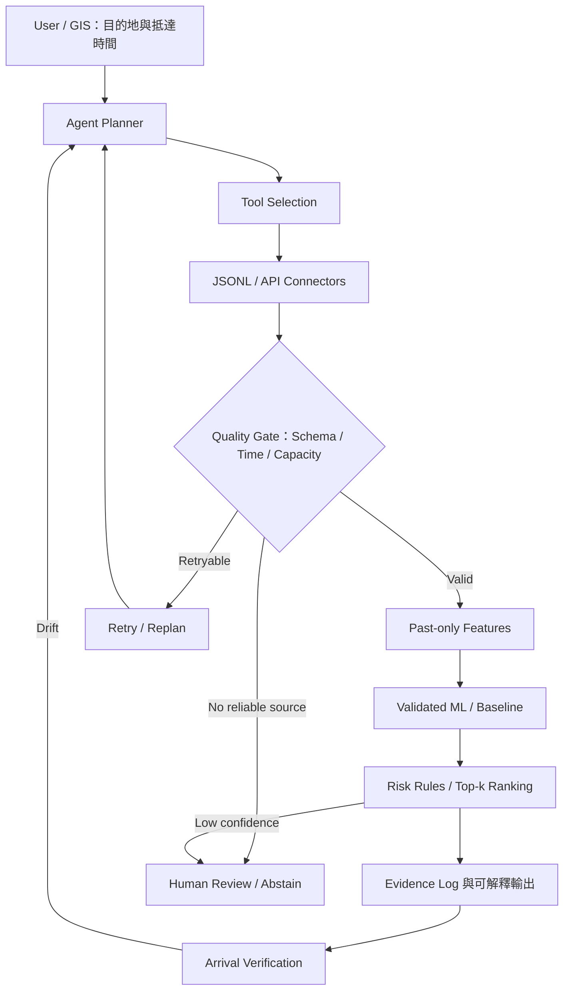

## DIC3 OpenSpec Proposal Refactor — 2026-11

> **Document refactor delivered through ChatGPT–GitHub Connector.** OpenSpec **spec-driven file structure** was authored and reviewed; **OpenSpec CLI commands were not executed**, and prediction experiments remain unrun. This is not a claim of native CLI validation, nor of completed New Taipei model evaluation.

### Newly added source materials — 2026-11-13

- [Uploaded original DESIGN.md](DESIGN.md) — supplied **after** the initial OpenSpec refactor; its primary deployed scope is the **Taichung information-only Agent**, while New Taipei is used for historical offline forecasting research. The design itself reports New Taipei phase-2 Persistence MAE **0.326757** as the strongest overall baseline, while New Taipei production inference and Taichung future predictions are **not validated/enabled**. Those figures have **not been independently reproduced in this repository**.
- [智慧停車提案解析.pdf](docs/submission/智慧停車提案解析.pdf) — original four-page proposal-analysis PDF provided for class submission.
- [Source scope reconciliation](docs/refactor/SOURCE_SCOPE_RECONCILIATION.md) — explains how the uploaded design relates to the previously New Taipei-oriented research proposal.
- Previously authored Introduction/Related Work are **proposal-oriented drafts derived from the old README**, not a verified rewrite of the newly supplied DESIGN.md. The new design creates a source alignment follow-up; do not present them as fully reconciled without a separate revision.

### Reviewer / instructor navigation

| Deliverable | GitHub file | Status |
| --- | --- | --- |
| OpenSpec change proposal | [proposal.md](openspec/changes/refactor-smart-parking-proposal/proposal.md) | Documented |
| Testable OpenSpec requirements | [spec.md](openspec/changes/refactor-smart-parking-proposal/specs/research-proposal-refactor/spec.md) | Documented |
| Design decisions | [design.md](openspec/changes/refactor-smart-parking-proposal/design.md) | Documented |
| Work checklist | [tasks.md](openspec/changes/refactor-smart-parking-proposal/tasks.md) | Documented / remaining constraints flagged |
| A–F + 5 core / 3 controversies / 10 questions | [RESEARCH_5_3_10.md](docs/research/RESEARCH_5_3_10.md) | Refactored |
| Chinese and IEEE-style English abstracts | [ABSTRACTS.md](docs/research/ABSTRACTS.md) | Refactored proposal text |
| Introduction | [INTRODUCTION.md](docs/research/INTRODUCTION.md) | Refactored research proposal |
| Related Work | [RELATED_WORK.md](docs/research/RELATED_WORK.md) | Refactored research proposal |
| References and evidence check | [REFERENCE_AUDIT.md](docs/references/REFERENCE_AUDIT.md) | Partial external audit; pending sources disclosed |
| Original repository README snapshot | [README_BEFORE.md](docs/baseline/README_BEFORE.md) | Preserved from commit `f060df0` |
| Before / After mapping | [BEFORE_AFTER.md](docs/refactor/BEFORE_AFTER.md) | README-based comparison |
| Acceptance and outstanding blockers | [ACCEPTANCE.md](docs/refactor/ACCEPTANCE.md) | Manual documentary audit; CLI NOT RUN |

**Scope restriction:** Original DOCX/PPTX, raw datasets and notebooks are **not present in this GitHub repository**; a standalone DESIGN.md was added later, after the initial document refactor, so their exact pre/post comparison and experiment reproducibility are still blocked. The originally submitted PDF/PNG are separate LMS attachments; no requirement to duplicate them in this repository has been established. The remainder of this README preserves the previous proposal outline.

---

# 智慧停車 AI Agent
## 新北市路邊停車可用性預測與風險感知推薦

**Smart Parking AI Agent for On-Street Parking Availability Prediction and Risk-Aware Recommendation in New Taipei City**

> 物聯網應用與資料分析｜Final Project Proposal｜2026 年 11 月  
> **狀態：Proposal / Prototype** — 以下明確區分既有原型成果與尚待驗證的研究目標。

## 1. 專題概述

停車資訊顯示「目前有空位」，不代表駕駛「抵達時仍有空位」。本專題聚焦**新北市路邊停車路段**，將歷史資料、即時 API、資料品質管理、預測模型與 AI Agent 結合，提供依**預計抵達時間**評估的 Top-k 停車候選與滿位風險。

使用者可輸入目的地、預計抵達時間、可接受步行距離、車種與偏好；系統預計輸出候選路段、預估剩餘車位或滿位機率、資料時間戳、來源、模型與限制。資料過期、API 失敗或信心不足時，Agent 應重新規劃（Retry / Replan）、退回基準方案、要求人工確認或明確棄權（Abstain），避免無依據的推薦。

### 研究目標

- 建立新北市路邊停車歷史資料的 schema、路段、時間、容量與品質檢查流程。
- 預測指定日期／時段抵達時的路段剩餘空位及滿位風險。
- 整合距離、資料新鮮度、品質與領域規則，提出可追溯的風險感知 Top-k 推薦。
- 在正常與異常情境比較 AI Agent 與固定 Pipeline 的效益。

## 2. Agent 系統架構（規劃）



**核心原則**

1. 資料品質優先於模型複雜度，先檢查來源、schema、時間戳、重複與容量。
2. 模型特徵只能取自預測 cutoff 前已知的資料，嚴格避免時間洩漏。
3. 每個候選的預測風險必須使用**該候選自己的 observation quality**。
4. 每次工具呼叫、重試、替代方案及建議均留下 evidence，便於事後驗證。
5. Agent 的價值須經固定 Pipeline 對照實驗證明，而非預設 Agent 較佳。

## 3. 資料來源

| 資料 | 用途 | 提案記載狀態 |
| --- | --- | --- |
| 新北市路邊停車歷史 JSONL | 主要路段觀測、歷史建模及抵達驗證 | **已取得**，涵蓋 2025/05/01–2026/11/02；全量 QA 未完成 |
| 新北市即時停車資訊 API | 最新觀測、來源新鮮度與例外處理 | Planned / Unverified |
| 新北抽樣預測 Notebook | 早期模型可行性 | 已有抽樣測試 MAE 約 **7.12 格** |
| UCI Parking Birmingham | 歷史資料品質方法及原型參考 | 既有 QA 原型；跨城市結論不可直接套用 |

**重要限制：**

- 新北 JSONL 的全量筆數、路段數、缺漏比例、時間解析度、容量異常與更新頻率尚待實測；**不能假設是即時或固定每 10 分鐘一筆**。
- 候選歷史主鍵為 `(source, segment_id, observed_at)`；實際欄位名與唯一性須依 schema 映射。
- 原始觀測應保留來源、觀測時間、擷取時間、HTTP 狀態與 payload hash；缺值、未知狀態不得直接視為空位。
- 現有抽樣 Notebook **使用 30 分鐘時段特徵、尚未納入路段 ID**；MAE ≈ 7.12 格**不是**新北全量模型正式成效，也不代表已驗證 10 分鐘預測。
- 本階段主要研究單位是**路邊路段**；路外停車場整合屬後續擴充。

## 4. Baseline、預測與推薦

| 類型 | 規劃方法 |
| --- | --- |
| Baseline | Persistence、同星期／同時段 Historical Median |
| 候選模型 | Random Forest、HistGradientBoosting |
| 特徵 | 路段識別、時間、lag、rolling，以及 cutoff 前已取得的合法外部資訊 |
| 滿位事件 | 抵達時合法觀測之 `available_spaces = 0` |
| 風險 | 預測剩餘格數、滿位機率、freshness、品質與校準 |
| 推薦 | 依風險、步行距離、車種及限制排序 Top-k，附上可追溯證據 |
| 例外處理 | Timeout／Stale／Schema Error → Retry／Replan；無可靠資料 → Human Review／Abstain |

只有在相同時間切分下穩定勝過簡單 Baseline，才考慮加入更複雜的 LSTM、Transformer 或時空模型。

## 5. 研究假設（Planned）

| 假設 | 待驗證問題 |
| --- | --- |
| **H1** | 加入可於 cutoff 前取得的路段及時間特徵後，模型 MAE 是否優於 Persistence？ |
| **H2** | 使用校準後滿位風險排序，能否提升抵達時 Top-3 至少有一處可停的比例？ |
| **H3** | 遇到 API 失敗、資料逾期等異常時，品質感知 Agent 是否比固定 Pipeline 減少無證據建議？ |

**H1–H3 目前均未完成正式實驗驗證。**

## 6. 評估與驗收設計

- **時間切分：**依日期排序 60% Train / 20% Validation / 20% Test；相同時間或重複群組不得跨集合。Test 僅在模型與門檻鎖定後使用一次。
- **預測：**MAE、RMSE，比較 Persistence 與 Historical Median。
- **滿位分類：**Recall、Precision、PR-AUC；於 Validation 選擇風險門檻。
- **校準：**Platt Scaling 或 Isotonic，評估 Brier Score、ECE、Reliability Diagram；不得使用 Test 擬合。
- **推薦：**Top-k Success、MRR、推薦距離、Coverage、Abstention Rate。
- **異常測試：**正常、API timeout、stale data、schema error；比較有效與無證據建議比率。
- **消融：**移除路段／外部特徵、品質懲罰、校準、Replan、Agent Planning，評估各元件實際貢獻。
- **Ground truth：**使用預計抵達時間**後**容許窗內第一筆合法觀測；超窗或缺資料標示 missing，不用過遠時間的觀測補值。

### Go / No-Go 目標（未達成前不得宣稱成功）

- [ ] 完成新北 JSONL 全量 Schema／Coverage／Time／Capacity QA。
- [ ] 全量模型 MAE 較 Persistence 改善 **≥ 5%**。
- [ ] 滿位 Recall **≥ 0.80**（目標）。
- [ ] Top-3 Success 較單純距離排序改善 **≥ 5 個百分點**。
- [ ] 校準後 Brier Score 改善。
- [ ] 端到端 p95 回應延遲 **≤ 3 秒**。

若品質或預測條件不足，應縮小範圍至資料可靠的路段、僅呈現歷史趨勢、退回 Baseline，必要時 Abstain。

## 7. 專案進度

以下是**提案文件描述的既有成果**，不表示這些程式或資料已經提交至本 GitHub 儲存庫。

| 項目 | Proposal 階段 | 後續工作 |
| --- | --- | --- |
| Connector、Quality、Persistence、Agent 原型 | Implemented / Verified（既有原型） | 整合正式新北資料 |
| Retry / Replan / Evidence | Implemented / Verified（既有原型） | 完整異常測試 |
| 自動化測試 | 既有 **9 項**測試 | 程式提交後於本 Repo 重跑 |
| 新北 JSONL 歷史資料 | Data obtained | 全量 QA、路段映射與時間檢查 |
| 新北預測 Notebook | 抽樣 MAE ≈ 7.12 格 | 路段特徵、全量訓練與嚴格時間切分 |
| H1–H3、Top-k、校準與消融實驗 | Planned / Unverified | 實測與驗收 |
| GIS Demo、效能與部署 | Planned | 前後端整合及延遲量測 |

### 開發路線

1. 匯入既有原型、測試與資料格式範例，補齊安裝／執行文件。
2. 完成新北 JSONL 全量資料品質與涵蓋分析。
3. 建立符合預測時距的路段特徵、Baseline 與候選樹模型。
4. 完成滿位風險校準、Top-k 排序及抵達 Ground Truth。
5. 整合 Agent、即時 API 與 GIS，加入異常注入及 Evidence Log。
6. 完成 H1–H3、Ablation、延遲與 Go / No-Go 報告。

### 執行方式

提案中記載既有原型的測試命令：

```bash
python -m unittest discover -s tests -v
```

> 原提案記載結果為 9 tests OK。**本 Repo 尚未包含原型程式與 `tests/` 時，這個指令無法直接執行**。待程式提交後再補充必要環境、安裝與啟動命令。

## 8. 研究參考

1. TDX 運輸資料流通服務：新北市路邊停車歷史 JSONL（本專題已取得資料）。
2. Ma et al., “A review of research on urban parking prediction,” 2024. [DOI](https://doi.org/10.1016/j.jtte.2023.11.004)
3. Cao et al., “An attention-based dynamic graph model for on-street parking availability prediction,” 2025. [DOI](https://doi.org/10.1016/j.tra.2025.104391)
4. Qian et al., “Curb parking occupancy prediction based on real-time fusion of multi-view spatial-temporal information using graph attention gated networks,” 2025. [DOI](https://doi.org/10.1016/j.asoc.2025.112781)
5. Schneble and Kauermann, “Statistical modelling of on-street parking spot occupancy in smart cities,” 2025. [DOI](https://doi.org/10.1093/jrsssc/qlaf017)
6. Nezhadettehad et al., “Uncertainty-Aware Parking Prediction Using Bayesian Neural Networks,” 2025. [DOI](https://doi.org/10.3390/s25113463)
7. Stolfi, “Parking Birmingham,” UCI Machine Learning Repository. [DOI](https://doi.org/10.24432/C51K5Z)

---

**Evidence first · Abstain when uncertain · Verify after arrival**
