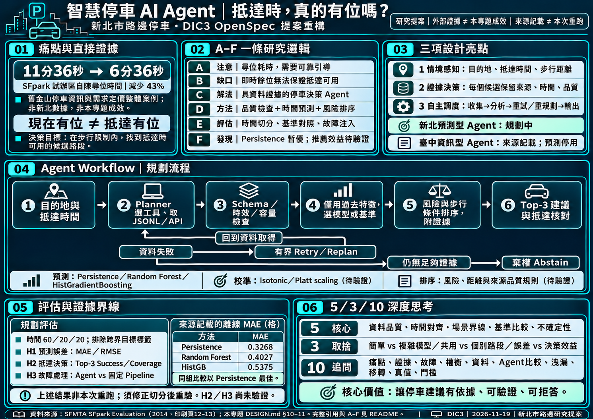

*點圖查看高解析原圖。深藍／青色技術藍圖延續原版風格；外部案例、來源記載與研究計畫分開標示。*

# 智慧停車 AI Agent｜DIC3 OpenSpec 提案重構

**研究主題：**新北市路邊停車抵達時間可用性預測與風險感知推薦  
**作業：**DIC3 — Project Proposal Refactor using OpenSpec

本儲存庫保存原始智慧停車提案與以 OpenSpec 規格驅動流程完成的學術文件重構，研究核心是從「目前有空位」提升到「抵達時是否可靠、風險多高、如何推薦」。

**直接痛點證據：**SFMTA 的 SFpark 評估記錄，試辦區平日 9–18 時自陳尋位時間由 **11 分 36 秒降至 6 分 36 秒（−43%）**；對照區下降 13%。這是舊金山停車資訊與需求定價等措施的整體案例，並非新北市數據或本 Agent 成效。[官方報告（印刷頁 12–13）](https://www.sfmta.com/media/11985/download?inline=)

**三項設計亮點：**情境感知（目的地、抵達時間與步行限制）、證據決策（每個候選的來源／時間／品質）、自主調度（收集、分析、重試／重規劃或棄權）。新北預測型 Agent 仍為待驗證提案。

**2026-11-18 課堂回饋修訂：**A–F、約 300 字中文摘要與英文摘要、具體方法與逐步 Workflow 已對齊；詳見[修訂對照](docs/refactor/CLASS_FEEDBACK_20261118.md)。

## 作業成果

| 核心成果 | 文件 |
| --- | --- |
| OpenSpec Change | [Proposal](openspec/changes/refactor-smart-parking-proposal/proposal.md) · [Specs](openspec/changes/refactor-smart-parking-proposal/specs/research-proposal-refactor/spec.md) · [Design](openspec/changes/refactor-smart-parking-proposal/design.md) · [Tasks](openspec/changes/refactor-smart-parking-proposal/tasks.md) |
| A–F 學術摘要 | [中文與 IEEE 英文摘要](docs/research/ABSTRACTS.md) |
| Agent 逐步運作與失敗處理 | [Agent Workflow](docs/research/AGENT_WORKFLOW.md) |
| 一頁資訊圖表 | [高解析 PNG](docs/assets/smart-parking-infographic-v2.png) |
| 五大核心思維／三項爭議／十大深問 | [研究分析](docs/research/RESEARCH_5_3_10.md) |
| Introduction | [研究動機、缺口與 H1–H3](docs/research/INTRODUCTION.md) |
| Related Work | [原始文獻 [5]–[13] 九項比較](docs/research/RELATED_WORK.md) |
| 文獻查核 | [Reference Audit](docs/references/REFERENCE_AUDIT.md) |
| 原稿與修訂章節對照 | [Before / After](docs/refactor/BEFORE_AFTER.md) |
| 資料城市與階段定義 | [Source Scope](docs/refactor/SOURCE_SCOPE_RECONCILIATION.md) |
| 驗收 | [Acceptance](docs/refactor/ACCEPTANCE.md) · [Manual Verification](docs/refactor/OPENSPEC_MANUAL_VERIFICATION.md) |
| OpenSpec 原生 CLI | [安裝與操作](OPENSPEC_SETUP.md) · [2.1.0 嚴格驗證 PASS](docs/refactor/OPENSPEC_CLI_VERIFICATION.md) |

## 原始資料

| 檔案 | 用途 |
| --- | --- |
| [新北市提案 DOCX](docs/submission/智慧停車AI_Agent_Proposal_新北市%281%29.docx) | 原始文字提案 |
| [新北市提案 PPTX](docs/submission/智慧停車AI_Agent_Proposal_新北市%281%29.pptx) | 原始 16 頁簡報 |
| [智慧停車提案解析 PDF](docs/submission/智慧停車提案解析.pdf) | 原始提案分析 |
| [DESIGN.md](DESIGN.md) | 系統設計及階段成果記錄 |
| [README_BEFORE.md](docs/baseline/README_BEFORE.md) | 重構基準快照 |

原始文件保留原貌；重構成果另存於 `docs/research/` 與 OpenSpec Change。

## 研究範圍與證據

**新北市**是抵達時間預測及風險感知 Top-k 推薦的研究對象；**臺中**已有來源文件記載的資訊型 Agent，未來車位預測功能仍為 **DISABLED**；**Birmingham** 僅作為資料品質與方法參考。

| 問題 | 目前證據 |
| --- | --- |
| H1：模型能否優於 Persistence？ | `DESIGN.md` 記載新北離線 Phase 2 整體 MAE：Persistence **0.326757**、Random Forest **0.402669**、HistGB **0.537539**。此結果**不支持樹模型在該整體比較中優於 Persistence**；需以修正跨切分標籤邊界後的實驗重新確認。 |
| H2：風險排序能否提高抵達 Top-3 Success？ | **Planned／Not Evaluated** |
| H3：Agent 能否在來源故障時優於固定 Pipeline？ | **Planned／Not Evaluated** |

原始提案另記載抽樣 MAE 約 **7.12 格**，與 Phase 2 的資料、切分及特徵條件不同，不能直接比較。Phase 2 數據是原設計文件記載的離線成果，**本儲存庫未提供可獨立重跑的資料與執行紀錄**；不代表新北市正式預測服務已上線。

## 驗收界線

- **OpenSpec 文件流程：**Proposal → Specs → Design → Tasks → Apply → Manual Verify；九項文件 Requirement／Scenario 已有逐項證據。
- **原生 OpenSpec CLI：**已安裝官方 **2.1.0**，執行 `openspec validate refactor-smart-parking-proposal --strict --no-interactive --json`，**PASS（1 passed／0 failed／0 issues）**；規格格式通過不代表模型成效通過。
- **研究結果：**H1 待可重現的 purged-split 驗證；H2/H3 尚未完成實驗。
- **正式繳交：**以課程平台實際要求為準；本儲存庫不代表已完成課程平台上傳。

詳細證據請參閱 [OpenSpec Manual Verification](docs/refactor/OPENSPEC_MANUAL_VERIFICATION.md)；本機 CLI 使用方式另見 [OPENSPEC_SETUP.md](OPENSPEC_SETUP.md)。

