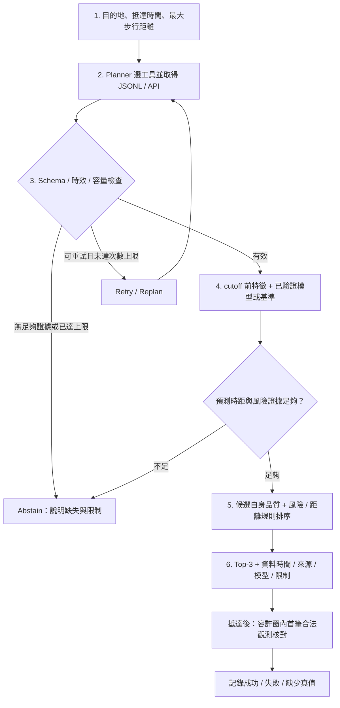

# Agent Workflow｜從查詢到抵達核對

**範圍：新北市路邊停車研究提案。**下列流程是待驗證的設計，不代表預測型 Agent 已上線。流程展開自 [DESIGN.md](../../DESIGN.md) §§1–7；來源記載的臺中資訊型 Agent 與新北研究分開呈現。

## 三組方法與責任

| 方法組 | 具體方法／工具 | 責任與界線 |
| --- | --- | --- |
| 情境與資料取得 | Planner、JSONL／HTTP JSON Connector、Schema／Freshness／Capacity Quality Gate | 解析目的地、抵達時間與步行限制；選擇來源並檢查每個候選的資料品質。Planner 不自行編造車位數。 |
| 時間預測與風險分析 | Persistence、Historical Median、Random Forest、HistGradientBoosting；Isotonic／Platt scaling 校準候選 | 僅使用 cutoff 前特徵；模型需先經時間切分驗證。校準方法屬研究計畫，未驗證前不把品質分數當滿位機率。 |
| 決策與自主調度 | 風險／距離／來源品質規則式 Top-k；有界 Retry／Replan；Abstain | 套用候選自身品質與步行條件，輸出建議、限制及來源；失敗時重新取得資料或改計畫，仍不足則棄權。排序權重與門檻只用驗證集選定。 |

校準候選 Isotonic／Platt scaling 沿用[原始提案 DOCX](../submission/智慧停車AI_Agent_Proposal_新北市%281%29.docx) §6.3；兩者均未在本次 DIC3 執行效能驗證。

## 逐步運作與失敗分支

資料不足時即使有 Persistence，也不能把失效觀測轉成可信預測；只有適用且輸入有效的基準可以替代模型。Retry 次數與來源時效門檻需在正式實驗前固定並記錄，不能無限重試。

## 一次查詢的輸入、輸出與證據

| 步驟 | 產出 | 檢核方式 |
| --- | --- | --- |
| 1–2 收集 | 查詢條件、來源選擇、原始觀測 | 有明確 request cutoff、目標抵達時間與路段 ID |
| 3 檢查 | 每候選的 Schema／時效／容量結果 | 缺漏或未知狀態不當作空位；品質不跨候選共用 |
| 4 分析 | 可用量估計、模型／基準名稱；有證據時才提供校準風險 | 特徵時間不超過 cutoff，目標時距與模型一致 |
| 5–6 行動 | Top-3、說明、證據；或明確棄權 | 可追溯來源時間、規則及失敗原因；不保證抵達有位 |
| 抵達核對 | 非滿位／滿位／缺少真值 | 無合法觀測標為 missing，不直接當成成功或失敗 |

## 如何證明 Agent 的價值

H3 以**相同來源、模型、工具、故障與計算預算**對照固定 Pipeline。注入 timeout、stale、schema error，檢查 Agent 是否確實收集資料、分析失敗原因並觸發 Retry／Replan 或 Abstain；同時報告有證據建議率、Coverage、Abstention 與 p95 延遲。僅能展示聊天或地圖，不能據此宣稱 Agent 優於固定流程。

H1／H2／H3 的定義與待驗證目標見 [Introduction](INTRODUCTION.md)；資訊圖表用同一流程的六步摘要，不另設一套方法。
